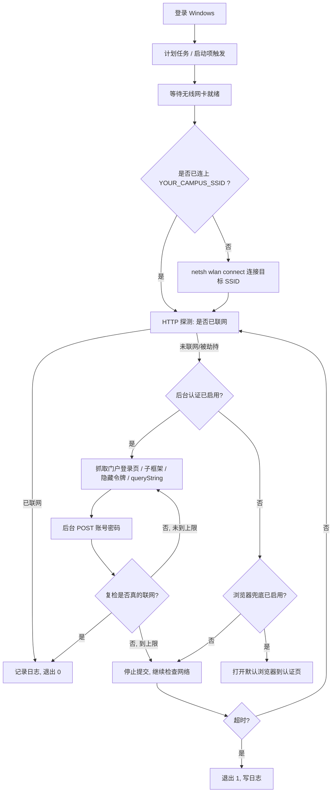

# 中国联通校园网自动连接（开机自启 + 后台认证）

面向 Windows 10/11：**开机登录后自动连上中国联通校园网 Wi-Fi（目标 SSID 在 `config/config.json` 中配置，模板里是 `YOUR_CAMPUS_SSID`），
在后台直接完成门户认证，全程不打开浏览器。**

> `YOUR_CAMPUS_SSID`、`YOUR_USERNAME`、`YOUR_PASSWORD`、`YOUR_PORTAL_HOST`
> 都是占位符。使用前请填写自己的值。

> 浏览器不能自己连 Wi-Fi，这是操作系统的活。本项目的分工是：
> Windows 负责“连上无线”，脚本负责“在后台提交门户认证”。



---

## 配置模板（使用前填写）

| 项目 | 值 |
|---|---|
| 目标 Wi-Fi | `YOUR_CAMPUS_SSID`（待填写） |
| 运营商 | 中国联通 |
| 认证账号 | `YOUR_USERNAME`（待填写） |
| 认证密码 | `YOUR_PASSWORD`（待填写，写入 `config/config.json`） |
| 默认认证方式 | **后台认证** `autoLogin.mode = eportal`（锐捷 ePortal），不打开浏览器 |
| 浏览器兜底 | 关闭（`browser.enabled = false`） |
| 计划任务名 | `Unicom-AutoConnect`（执行 `scripts/install.ps1` 后注册） |

> 联通校园网常见的有锐捷 ePortal 等门户。锐捷 ePortal 的登录不是提交页面上的可见表单，
> 而是由页面 JS（`AuthInterFace.js` 的 `doauthen`）把 `userId / password / service / queryString`
> 双重 URL 编码后 POST 到 `InterFace.do?method=login`。项目的 `eportal` 模式完整复现了这个流程。
> 实际门户地址形如 `http://YOUR_PORTAL_HOST/eportal/index.jsp?...`，各校不同，
> 请用 `scripts\capture-portal.ps1` 抓取后填写。
>
> 其他学校的联通门户如果是普通表单，也可以把 `autoLogin.mode` 改成 `portal-form`；
> 如果是验证码 / JS 加密 / 其他专用协议，见文末「适配说明」。

## 目录结构

```text
Unicom-AutoConnect-GitHub/
├── src/
│   ├── CampusNet.psm1           核心模块：无线连接 / 联网探测 / 门户发现 / ePortal 与表单后台认证 / 可选浏览器
│   └── Connect-CampusNet.ps1    主入口（计划任务实际执行的就是它）
├── config/
│   ├── config.example.json      带说明的配置模板
│   └── config.json              实际配置（已 gitignore，首次使用请填写；模板里是占位符）
├── scripts/
│   ├── install.ps1              安装开机自启（计划任务 / 启动文件夹）
│   ├── uninstall.ps1            卸载
│   ├── status.ps1               一键诊断
│   ├── prepare-wifi.ps1         无线配置检查 / 导入 / 自动连接设置
│   ├── capture-portal.ps1       抓包助手：解析门户登录表单，生成 autoLogin 配置
│   ├── run-now.cmd              双击即手动跑一次
│   ├── capture-portal.cmd       双击即运行抓包助手
│   └── status.cmd               双击即看诊断
├── tests/
│   └── Test-CampusNet.ps1       离线自检（本地模拟门户，不联网不改系统）
├── extension/                   可选：Chromium 扩展，浏览器兜底时自动填表
├── tools/
│   └── Normalize-Encoding.ps1   开发用：统一源码编码（.ps1 加 UTF-8 BOM）+ 语法检查
└── logs/                        运行日志与状态（自动生成，已 gitignore）
```

## 三分钟上手

> **第 0 步：先填配置。** 克隆后 `config/config.json` 默认不存在（已被 `.gitignore` 排除），
> 先复制模板：
>
> ```powershell
> Copy-Item .\config\config.example.json .\config\config.json
> ```
>
> 然后把 `YOUR_CAMPUS_SSID`、`YOUR_USERNAME`、`YOUR_PASSWORD` 替换成实际值。
> 不填的话，脚本会去连占位 SSID，并因为账号密码为空而跳过认证。

0. **确认 Windows 里已经有这个 Wi-Fi 的配置文件**（本项目只负责“连接”，不负责“首次输入 Wi-Fi 密码”）：

```powershell
netsh wlan show profiles
```

   能看到你的实际 SSID 就行。下面命令里的 `YOUR_CAMPUS_SSID` 请替换成实际 SSID。没有的话，先手动点一次任务栏 Wi-Fi 连上它；或者从别的电脑导出 XML 再导入：

```powershell
netsh wlan export profile name="YOUR_CAMPUS_SSID" folder=.
powershell -NoProfile -ExecutionPolicy Bypass -File .\scripts\prepare-wifi.ps1 -Ssid "YOUR_CAMPUS_SSID" -ImportXml .\YOUR_CAMPUS_SSID.xml
```

1. **先跑一次诊断**（双击）→ `scripts\status.cmd`
   确认：无线网卡可用、目标 SSID 正确、配置文件存在、后台认证已启用、当前是否已联网。

2. **手动跑一次完整后台认证**（双击）→ `scripts\run-now.cmd`
   如果当前没联网，脚本应该会：连 Wi-Fi → 发现门户 → 后台 POST 账号密码 → 复检联网成功。
   全程不需要浏览器，也不会弹认证页。

3. **装开机自启**（PowerShell 里执行）：

```powershell
powershell -NoProfile -ExecutionPolicy Bypass -File .\scripts\install.ps1
```

   想先看看会做什么、不动系统：

```powershell
powershell -NoProfile -ExecutionPolicy Bypass -File .\scripts\install.ps1 -DryRun
```

   不需要管理员权限的替代方案（在“启动”文件夹放快捷方式）：

```powershell
powershell -NoProfile -ExecutionPolicy Bypass -File .\scripts\install.ps1 -Mode StartupFolder
```

   卸载：

```powershell
powershell -NoProfile -ExecutionPolicy Bypass -File .\scripts\uninstall.ps1
```

> **注意**：如果目标机器之前装过其他版本的校园网自启任务（例如已经有一个 `Unicom-AutoConnect`
> 或 `CUCC-AutoConnect`），请先卸载 / 禁用旧的，只保留一个认证脚本，避免两个脚本同时提交登录。
> 本项目的 `install.ps1` 只会覆盖同名的 `Unicom-AutoConnect`，不会动其他名字的任务。

## 后台认证是怎么做的

### `eportal` 模式（默认，锐捷 ePortal）

1. 用微软 NCSI / 谷歌 204 探测是否已经联网；
2. 没联网时，从 302 `Location`、`meta refresh`、JS 跳转或当前劫持页拿到门户地址
   （实际地址形如 `http://YOUR_PORTAL_HOST/eportal/index.jsp?wlanuserip=...&wlanacname=...&mac=...`，各校不同，用 `capture-portal.ps1` 抓取）；
3. GET 门户页，保留会话 Cookie，并取出地址栏 `?` 之后的整段 `queryString`；
4. 按页面 `doauthen` 的规则，把 `userId`、`password`、`service`、`queryString`
   各做**两次** `encodeURIComponent`（PowerShell 里是两次 `EscapeDataString`）；
5. POST 到 `./InterFace.do?method=login`，请求体形如：
   `userId=...&password=...&service=...&queryString=...&operatorPwd=&operatorUserId=&validcode=&passwordEncrypt=false`；
6. 解析接口返回的 JSON：`result=success` 或 `wait` 都继续；
7. **最终以联网探测为准**：能重新打开网页才算认证成功，避免门户返回“假成功”。

### `portal-form` 模式（通用表单门户）

1. GET 门户首页；如果首屏是 `frameset` / `iframe`，跟进子框架，挑“最像登录表单”的那个；
2. 解析表单：提交地址、提交方法、所有 `input` / `select` 字段；账号框和密码框自动识别；
3. 如果 `<form action="">` 是空的，扫门户引用的 JS，找出 `forms[0].action = "/..."` 这类真实提交地址；
4. 隐藏字段（含一次性令牌）原样带回，填上账号密码，按 `application/x-www-form-urlencoded` POST；
5. 请求带上 `Referer`、浏览器 UA、Cookie 会话；同样以联网复检结果为准。

登录接口有时会“收下请求但不回响应”，客户端会超时；这种情况不会直接判失败，而是交给复检联网状态判断。

## 三种认证方式

| 方式 | 配置 | 效果 | 当前状态 |
|---|---|---|---|
| A. 后台认证（默认） | `autoLogin.enabled = true` | 后台直接提交账号密码（默认走 ePortal 协议），**完全不弹浏览器** | **已启用** |
| B. 浏览器兜底 | `browser.enabled = true` | 后台认证失败后打开默认浏览器到门户，手动点登录 | 关闭 |
| C. 浏览器扩展自动填表 | 装 `extension/` + 填账号 | 浏览器兜底时自动填账号密码并提交 | 可选，未启用 |

默认只走 A。A 连续失败 `autoLogin.maxAttempts` 次后会停止提交，避免学校门户锁账号；如果 B 没开，脚本会继续检查网络直到总超时。

### 启用浏览器兜底

只在后台认证搞不定（验证码、复杂 JS 加密等）时再用：

```json
"browser": {
  "enabled": true
}
```

然后把 `extension/` 加载到 Chromium 浏览器，扩展会在门户页自动填表。
不装扩展也可以，只是需要手动点一下登录。

## 配置说明（`config/config.json`）

| 字段 | 含义 | 当前值 / 备注 |
|---|---|---|
| `ssid` | 目标无线名，按优先级排列 | `["YOUR_CAMPUS_SSID"]` |
| `profileName` | Windows 无线配置文件名 | 留空 = 取 `ssid` 第一项 |
| `interfaceName` | 无线网卡名（如 `WLAN`） | 留空让 netsh 自动选 |
| `connectTimeoutSeconds` | 单次连接 SSID 的超时 | 45 |
| `overallTimeoutMinutes` | 整轮重试总时长 | 15 |
| `retryIntervalSeconds` | 每轮间隔 | 10 |
| `autoLogin.enabled` | 是否启用后台认证 | `true` |
| `autoLogin.mode` | `eportal` / `portal-form` / `static` | `eportal`（锐捷 ePortal） |
| `autoLogin.eportalService` | ePortal 的可选 `service` 参数 | 留空即可，学校要求选服务时再填 |
| `autoLogin.portalUrl` | 手工指定门户地址 | 留空 = 自动探测（推荐） |
| `autoLogin.submitUrl` | 真实提交地址，可写相对路径 | 留空 = 用表单 action（含 JS 动态 action） |
| `autoLogin.username` | 认证账号 | `YOUR_USERNAME` |
| `autoLogin.password` | 认证密码 | `YOUR_PASSWORD`（待填写） |
| `autoLogin.usernameField` | 账号字段名 | 留空自动识别；识别不准时手工填 |
| `autoLogin.passwordField` | 密码字段名 | 留空自动识别；识别不准时手工填 |
| `autoLogin.extraFields` | 额外固定提交字段 | 如 `{ "serviceType": "301" }` |
| `autoLogin.maxAttempts` | 一轮最多尝试几次 | 3（防止锁账号） |
| `autoLogin.timeoutSeconds` | 单次请求超时 | 20 |
| `browser.enabled` | 浏览器兜底 | `false`（纯后台） |
| `browser.url` | 手工指定门户地址 | 留空自动探测 |
| `browser.fallbackUrl` | 探测不到门户时的兜底地址 | 打开它会触发运营商跳转 |
| `probes` | 联网判定规则 | 默认微软 NCSI + 谷歌 204 |
| `logging.keepDays` | 日志保留天数 | 14 |

`static` 模式只适合提交地址和字段都固定的门户；带一次性令牌的门户必须用 `portal-form`，否则第二次就失效。
锐捷 ePortal 不要用 `portal-form`：页面上的可见表单只是摆设，真正的登录接口是 `InterFace.do?method=login`，必须用 `eportal` 模式。

## 适配说明：不同学校的联通门户

先在不认证的状态下双击 `scripts\capture-portal.cmd`（或运行 `capture-portal.ps1`）。
它会自动找门户、跟进框架页、解析所有字段，并把结果留档到 `logs\capture-last.txt`。
如果识别到锐捷 ePortal（URL 含 `/eportal/`，或页面里有 `InterFace.do?method=login` / `AuthInterFace`），
它会自动建议 `mode = eportal`；否则建议 `portal-form`。
如果当前已经能上网，门户不会返回登录表单，可以手动指定地址：

```powershell
powershell -ExecutionPolicy Bypass -File .\scripts\capture-portal.ps1 -Url http://YOUR_PORTAL_HOST/portal -Write
```

抓包结果可以直接写回 `config.json`（`-Write` 会保留已填的账号密码）：

```powershell
powershell -ExecutionPolicy Bypass -File .\scripts\capture-portal.ps1 -Write
```

常见调整：

- **确认是锐捷 ePortal**：`autoLogin.mode` 保持 `eportal`，不要填字段名 / 提交地址；
- **普通表单门户**：`autoLogin.mode` 改成 `portal-form`；
- **字段名识别不准**：把 `autoLogin.usernameField` / `passwordField` 改成抓到的 `name`；
- **提交地址不是表单 `action`**：把 `autoLogin.submitUrl` 改成抓到的地址（相对路径也行）；
- **需要额外固定字段**：填 `autoLogin.extraFields`；ePortal 的服务名填 `eportalService`；
- **门户地址固定**：填 `autoLogin.portalUrl`，跳过自动发现；
- **门户要求先访问某个页面拿 Cookie**：static 模式下可配 `preRequestUrl`。

> **纯 HTTP 后台认证的边界**：如果门户使用图形验证码、短信验证码、动态口令，
> 或者密码在 JS 里做了新的加密 / 挑战应答（不同厂商、不同版本可能不一样），
> 单纯 POST 无法完成认证。这时只能：
> 1) 打开 `browser.enabled` 用浏览器兜底（可配合 `extension/` 自动填表）；或
> 2) 按抓包结果扩展 `src/CampusNet.psm1` 里对应的登录函数（ePortal 是 `Invoke-CampusEportalLogin`，普通表单是 `Invoke-CampusPortalFormLogin`）。
> 项目不会假装能绕过验证码或加密。

## 常见问题

**Q：SSID 到底叫什么？**
任务栏点 Wi-Fi 图标看，或执行 `netsh wlan show interfaces`。模板里的占位符是 `YOUR_CAMPUS_SSID`，请在 `config/config.json` 中改成实际 SSID。

**Q：提示“未找到无线配置文件”**
说明这台电脑从没连过该 Wi-Fi，Windows 里没有它的凭据。先手动连一次（输一次 Wi-Fi 密码），之后 Windows 会记住；
或者从别的电脑导出 XML 再导入（见上面的命令）。

**Q：为什么完全不弹浏览器？**
这是默认设计：`config.json` 里 `browser.enabled = false`，只走后台认证。
如果只是想让浏览器打开认证页，把它改成 `true` 即可；`-NoBrowser` 参数可以临时强行禁止浏览器。

**Q：怎么看后台认证到底提交了什么？**
看 `logs\connect-YYYYMMDD.log`。ePortal 模式会记录：
门户地址、提交到 `InterFace.do?method=login` 的 queryString 长度、接口返回的 JSON、复检结果；
普通表单模式会记录：识别到的账号/密码字段、带回的字段数量、提交地址、HTTP 状态、复检结果。
`logs\capture-last.txt` 里还有门户表单的完整字段清单。

**Q：后台认证失败，会不会把账号锁了？**
默认一轮最多尝试 3 次（`autoLogin.maxAttempts`），达到上限后停止提交，继续检查网络直到超时。
如果学校门户策略很严，可以把它改成 1 或 2。

**Q：怎么让它掉线后自动重连？**
安装时加重复间隔即可（每 30 分钟检查一次）：

```powershell
powershell -NoProfile -ExecutionPolicy Bypass -File .\scripts\install.ps1 -RepeatMinutes 30
```

**Q：怎么改延迟？**
重新注册一遍即可（会覆盖旧的）：

```powershell
powershell -ExecutionPolicy Bypass -File .\scripts\install.ps1 -DelaySeconds 60
```

**Q：怎么确认它真的能跑？**
手动触发一次计划任务：

```powershell
Start-ScheduledTask -TaskName Unicom-AutoConnect
```

或跑离线自检（本地模拟门户，不联网也不改系统）：

```powershell
powershell -NoProfile -ExecutionPolicy Bypass -File .\tests\Test-CampusNet.ps1
```

**Q：日志在哪？**
`logs\connect-YYYYMMDD.log`，状态另存于 `logs\state.json`。

**退出码**：0 = 已联网 / 认证成功；1 = 超时未认证；2 = 没有可用无线网卡。
